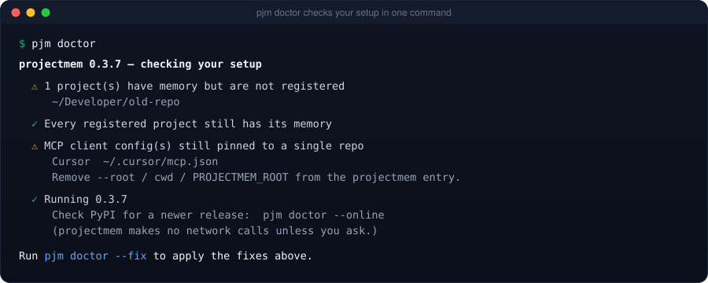
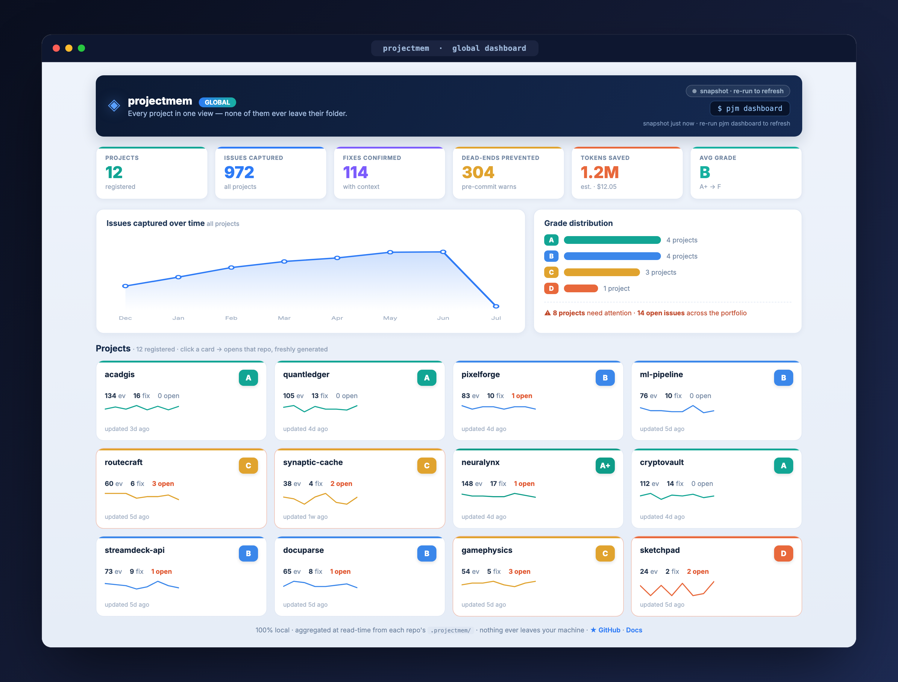

<!-- mcp-name: io.github.riponcm/projectmem -->

<div align="center">
  

  <h1>projectmem: memory for AI coding agents</h1>

  <p><b>We don't make AI smarter. We make it experienced.</b></p>

  <p>
    <a href="https://pypi.org/project/projectmem/"></a>
    <a href="https://pypi.org/project/projectmem/"></a>
    <a href="https://pepy.tech/project/projectmem"></a>
    <a href="https://github.com/riponcm/projectmem/stargazers"></a>
    <a href="https://opensource.org/licenses/MIT"></a>
    <a href="https://arxiv.org/abs/2606.12329"></a>
  </p>

  <p>
    <a href="https://ossdrop.com/tool/projectmem"></a>
  </p>

  <p>
    <a href="https://projectmem.dev"><b>Website</b></a> •
    <a href="https://projectmem.dev/guide"><b>Guide</b></a> •
    <a href="https://projectmem.dev/demo"><b>Demo</b></a> •
    <a href="https://github.com/riponcm/projectmem/blob/main/CHANGELOG.md"><b>Changelog</b></a> •
    <a href="https://arxiv.org/abs/2606.12329"><b>Paper</b></a>
  </p>

  <p>
    <a href="https://github.com/riponcm/projectmem/blob/main/CHANGELOG.md"><b>🎉 v0.3.7 is out</b></a> —
    one command connects your AI client, and <code>pjm import</code> brings your history over from agentmemory or mem0.
  </p>
</div>

## What is projectmem?

**projectmem is a local-first memory and judgment layer for AI coding agents.**
It records a project's issues, fix attempts (failed, partial and worked), fixes
and decisions as plain files inside the repository. At the start of each session
it gives Claude Code, Codex, Cursor, Antigravity or Claude Desktop a short summary
of what the project already learned. Before the agent edits or commits a file, it
warns when an approach on that file has already failed.

- **For:** developers who work with AI coding agents and are tired of re-explaining
  the project, and of watching the agent retry a fix that failed last week.
- **Local-first:** memory lives in `.projectmem/` in your repo. No cloud, no
  account, no API key, no telemetry.
- **One MCP server for every project:** 19 tools, set up once per client with
  `pjm init --agent <client>`.
- **Typed events, not chat logs:** issue, hypothesis, attempt, fix, decision and
  note. That structure is what makes the warnings possible.
- **Small at session start:** about 3,700 to 7,600 tokens, measured on nine real
  projects.
- **Open source:** MIT licence, Python 3.10+, macOS, Linux and Windows. Described
  in the paper [arXiv:2606.12329](https://arxiv.org/abs/2606.12329).

<div align="center">

https://github.com/user-attachments/assets/e055988e-7253-4ba9-92fc-95d3d4bcd763

</div>

## Why AI coding agents need memory

Every new session starts from zero. The agent forgets yesterday's decisions,
retries debugging approaches that already failed, and spends thousands of tokens
re-reading source files to rebuild context it had the day before.

Telling the agent to check its notes first is not enough. On one real project,
agents looked up a file's history before only **11% of 8,355 edits**, even though
their instructions asked for it every time
([measurements in #37](https://github.com/riponcm/projectmem/issues/37)). So
projectmem brings the lessons to the agent: right before an edit, and again at
`git commit`.

Git records *what* changed. projectmem records *why*: what was tried, what failed,
and what was decided.

## Quick start

### New to projectmem

####  Install projectmem

```bash
pipx install projectmem          # or: pip install projectmem
```

####  Connect your AI client

```bash
cd your-project
pjm init --agent claude-code     # or: codex, cursor, antigravity, claude-desktop
```

`pjm init` creates `.projectmem/` and installs three git hooks. `--agent` adds
the projectmem MCP server to that client's config, once for every project, and
for Claude Code and Codex also the edit hook that shows a file's lessons before
each edit. Your other MCP servers and settings are left as they are.

####  Start a new session

Start a new session, or fully quit and reopen a desktop app: MCP servers only
load on start. Your agent then loads the project's memory itself. In each new
repository after that, `pjm init` is all it takes.

**Rather let your AI do it?** Paste this into Claude Code, Codex or Cursor:

```text
Set up projectmem for this project: install it with `pipx install projectmem`
(or `pip install projectmem`), then run `pjm init --agent <client>` here with
the client you are running in: claude-code, codex, cursor, antigravity or
claude-desktop. Show me the output, then tell me to start a new session.
```

### Already using projectmem? Upgrade

This works from any earlier version. Your existing MCP setup keeps working:
since 0.3.0 one MCP server serves every project.

####  Update projectmem

```bash
pip install -U projectmem        # or: pipx upgrade projectmem
```

####  Find and register projects from older versions

```bash
pjm doctor --fix
```

####  Refresh each project

```bash
pjm init                         # run once in each project; your memory is kept
```

This refreshes the project's agent instructions and hooks.

####  Connect another AI client (optional)

```bash
pjm init --agent cursor          # or: claude-code, codex, antigravity, claude-desktop
```

The clients you already set up are not touched. On Claude Code and Codex this
also installs the edit hook that shows a file's lessons before every edit, so
run it once there if you set projectmem up before 0.3.6. A client that is
already connected stays as it is, unless its entry points to an old install,
which is updated.

### Check your setup with `pjm doctor`

<p align="center">
  
</p>

`pjm doctor` looks where code usually lives (`~/Developer`, `~/code`,
`~/projects`, cloud folders, and every drive on Windows) and reports:

- **projects with memory that aren't registered yet**, so the MCP server can't
  reach them. `pjm doctor --fix` registers them; `pjm project register <path>`
  adds one it missed.
- **registered projects whose memory is gone**, such as a moved or deleted repo.
- **client configs still pinned to one repository** with `--root`, `cwd` or
  `PROJECTMEM_ROOT`, the most common reason a new project is invisible to your
  agent. A pin may be deliberate, so remove it by hand.
- **your version.** `pjm doctor --online` also checks PyPI for a newer release;
  projectmem makes no network calls otherwise.

### More ways in

- **Another MCP client, or prefer to paste the config yourself?** Run `pjm init`
  without `--agent`; it prints the config with your Python path filled in. See
  [Connect a client by hand](#connect-a-client-by-hand).
- **Coming from agentmemory or mem0?**
  `pjm import <export.json> --from agentmemory` (or `--from mem0`) brings your
  decisions, lessons and past failures over. See
  [Import from another memory tool](#import-from-another-memory-tool).
- **Want every step with real output?** Follow
  [the complete setup guide](https://projectmem.dev/blog/projectmem-complete-guide-ai-coding-agent-memory).

## What your agent sees

**Right before it edits a file** (Claude Code and Codex, through the edit hook):

```text
projectmem lessons for src/auth/refresh.ts:
  Open issues on this file:
    - #0001 Token refresh races under parallel requests
  Earlier attempts (1 failed, 1 partial), newest first:
    ~ Retry on 401 halves the failures (#0001, 2026-11-28)
    x Wrapped the refresh call in a mutex (#0001, 2026-11-28)
  Decisions on this file:
    - Refresh tokens rotate per user and are never shared (2026-11-28)
```

Each file is shown once per session, and a file without lessons adds nothing.
Other clients get the same lessons from the `precheck_file` tool.

**At `git commit`**, from the pre-commit hook:

```text
$ git commit -m "switch auth to JWT"

projectmem: Pre-Commit Check
─────────────────────────────────────────────
  src/auth/middleware.py
    WARN  What already failed here (2 attempts):
           ✗ tried switching to JWT middleware (2d ago)
           ✗ patched session timeout to 60min (5d ago)
    WARN  HIGH CHURN: 5 changes in last 30 days
    WARN  1 possibly-stale memory cites this file
           decision [evt_9db5a3f8…] "auth uses session
           cookies, 30min timeout" — predates 7 commits
           Confirm it still holds, or retire it:
           pjm decision "..." --supersedes <id>
─────────────────────────────────────────────
3 warning(s). Review before committing.
```

Need quiet for a refactor? `pjm precheck --snooze 2h` pauses the warnings, and
the pause itself is logged.

## How projectmem helps

- **Stops repeated dead ends.** Failed and partial attempts are stored per file
  and shown before the next edit or commit on that file, however long ago they
  happened.
- **Starts every session where the last one ended.** `start_session()` returns
  the rules, the memory summary and the current plan in one call. `pjm brief`
  gives you the same picture in one screen.
- **Keeps decisions current.** A decision that cites a file is checked against
  that file's git history and flagged when the code has moved on. A newer
  decision retires an older one with `--supersedes`; nothing is ever deleted.
- **Shares what the team learned.** The distilled files are committed, so a
  teammate's agent knows the project's history after `git clone`.
- **Carries library lessons across projects.** Gotchas about a library live in
  `~/.projectmem/global/` and reach new projects that use the same stack.
- **Works with agents that have no MCP.** `pjm export --claude-md` writes the
  decisions, gotchas and a "these already failed" list into `CLAUDE.md` or
  `.cursorrules`.
- **Shows the history.** `pjm visualize` opens a local dashboard of every case
  the project solved and what failed on the way, and `pjm dashboard` gives one
  view across all your projects without copying their data anywhere.

## See your project's memory

`pjm visualize` opens a local dashboard for one project, and `pjm dashboard`
opens one view across all of them. Both are built from the files in
`.projectmem/` on your machine; nothing is uploaded.

<p align="center">
  
  <br /><sub><b>Overview</b>: every case the project solved, what failed on the way, and what it saved.</sub>
</p>

<table>
  <tr>
    <td width="50%" align="center">
      
      <br /><sub><b>Global dashboard</b> (<code>pjm dashboard</code>): all your projects in one view, aggregated at read time.</sub>
    </td>
    <td width="50%" align="center">
      
      <br /><sub><b>Project Map · Flow</b>: what happened, file by file, flowing into memory. Files that keep failing glow red.</sub>
    </td>
  </tr>
  <tr>
    <td width="50%" align="center">
      
      <br /><sub><b>Timeline · Time Spine</b>: problems on the left, knowledge on the right, real time down the middle.</sub>
    </td>
    <td width="50%" align="center">
      
      <br /><sub><b>Showoff · Universe</b>: your project as a galaxy; every star is a real issue, attempt, fix or decision. Record it as a clip to share.</sub>
    </td>
  </tr>
</table>

## How it works

```text
your agent (MCP tools) ─┐
pjm CLI ────────────────┼──▶ .projectmem/events.jsonl ──▶ summary.md, PROJECT_MAP.md, issues/
git hooks ──────────────┘    append-only log, local          distilled, small, committed
                                                                      │
   start_session(), precheck_file(file_path), edit hook, pre-commit ◀┘
```

1. **Capture.** The agent logs work through MCP tools (`log_issue`,
   `record_attempt`, `record_fix`, `add_decision`, `add_note`), you can do the
   same with `pjm log`, `pjm attempt` and friends, and the git hooks classify
   commits and reverts. Secrets are redacted before anything touches disk.
2. **Distill.** Every write rebuilds `summary.md` and the issue files from the
   append-only `events.jsonl`. The agent reads the small files, never the raw log.
3. **Use.** At session start the agent loads the summary. Before an edit or a
   commit, projectmem checks the file's history and warns.

Session-start cost, measured on 0.3.5 with the `cl100k_base` tokenizer on nine
real projects of 9 to 238 events:

| Access mode | Tokens per session | How it works |
|---|---|---|
| No projectmem (baseline, estimate) | 5,000 – 20,000+ | The agent re-reads source files every session |
| **MCP** *(recommended)* | **~3,700 – 7,600** at session start | `start_session()` once, then `get_issue(issue_id)` or `precheck_file(file_path)` only when relevant |
| Markdown only | ~3,700 – 7,600 | The agent reads the three distilled files |
| `pjm wrap` (estimate) | 500 – 2,000 | A pre-built context block within a budget you set |

`AI_INSTRUCTIONS.md` is about 3,300 tokens in every project; the summary ranged
from about 400 to 3,500 tokens and the project map from about 100 to 900.

## What's new in 0.3.7

- **One command connects your AI client.** `pjm init --agent claude-code` (or
  `codex`, `cursor`, `antigravity`, `claude-desktop`) writes the MCP config for
  you, plus the edit hook for Claude Code and Codex.
- **`pjm import` from agentmemory and mem0.** Decisions, lessons and past
  failures come over; raw activity stays behind.
- **Private keys are redacted whole**, not just their first line. Contributed by
  [@bardrop](https://github.com/bardrop)
  ([#38](https://github.com/riponcm/projectmem/pull/38)).
- **Backfill handles a `|` in a commit message**, so `pjm init` imports your git
  history again. Reported by [@Fonsi44](https://github.com/Fonsi44)
  ([#39](https://github.com/riponcm/projectmem/issues/39)).

Earlier releases: 0.3.6 added the edit hook and `start_session()`, and 0.3.0 one
MCP server for every project. Every release is in the
[changelog](https://github.com/riponcm/projectmem/blob/main/CHANGELOG.md).

## How it compares

| Capability | **projectmem** | claude-mem | agentmemory | mem0 | Letta |
|---|:---:|:---:|:---:|:---:|:---:|
| Core focus | **Memory + judgment** | Session capture | Memory engine | Chat / user memory | Agent harness |
| Warns before a commit from a file's own failure history | ✅ | ❌ | ❌ | ❌ | ❌ |
| Checks memory for staleness against git history | ✅ | ❌ | 🟡 links sessions to commits; time decay | ❌ | ❌ |
| Failed attempts as typed events | ✅ worked / partial / failed | 🟡 bugfix type | 🟡 captures tool failures | ❌ | ❌ |
| Keeps superseded memories (no deletion) | ✅ | ? | 🟡 versioned, but decay can evict | ✅ add-only since v3 | ✅ git-versioned memory |
| Cross-project lessons | ✅ stack-scoped with a manifest | 🟡 opt-in flag | 🟡 cross-project search | 🟡 user-scoped | 🟡 per agent |
| Runs locally with no LLM API key | ✅ | 🟡 local store, LLM compression | ✅ keyless mode | ❌ self-host needs a key | 🟡 local mode |
| Native MCP server | ✅ 19 tools | ✅ | ✅ 54 tools | 🟡 hosted only | ❌ MCP client |
| Price · licence | Free · MIT | Free · Apache-2.0, paid Pro | Free · Apache-2.0 | Free tier · Apache-2.0, paid cloud | Free tier · Apache-2.0, paid cloud |

<sub>✅ yes · 🟡 partial · ❌ not found in the project's own docs · ? not documented. Snapshot taken 2026-10-02 from each project's README, docs and changelog; design capabilities, not benchmark results. Corrections welcome — [open an issue](https://github.com/riponcm/projectmem/issues).</sub>

## FAQ

### Does projectmem send my code or memory to the cloud?

No. Everything stays in `.projectmem/` in your repository and in
`~/.projectmem/` for cross-project lessons. There is no account and no telemetry,
and the MCP server is a local process your client starts. The only network call
projectmem can make is an update check you turn on with `pjm doctor --online`.

### Which AI coding tools does it work with?

Claude Code, Codex, Cursor, Antigravity and Claude Desktop are set up with
`pjm init --agent`, and any other MCP client works with the config `pjm init`
prints. The edit hook runs in Claude Code and Codex; other clients get the same
lessons from the `precheck_file` tool.

### How is it different from CLAUDE.md, AGENTS.md or Cursor rules?

Those files hold instructions you write by hand. projectmem keeps a log of what
actually happened in the project, distills it into a summary, and warns at edit
and commit time from a file's own history. It also writes a short bridge into
`CLAUDE.md` and `AGENTS.md` so agents know to use it, and
`pjm export --claude-md` fills `CLAUDE.md` for agents without MCP.

### How is it different from mem0, agentmemory or claude-mem?

Those are general memory engines: they store conversations, observations or
facts and retrieve them by similarity. projectmem stores only a coding project's
issues, attempts, fixes, decisions and notes, and uses them to judge the next
action, warning before a repeated failure. See [How it compares](#how-it-compares).

### How many tokens does it add?

About 3,700 to 7,600 tokens at session start, measured on nine real projects.
Other tools, such as `precheck_file`, add only what the agent asks for. Without
memory, an agent typically spends 5,000 to 20,000 tokens or more re-reading
source files (an estimate). See [How it works](#how-it-works).

### Can I bring my memory over from agentmemory or mem0?

Yes, with `pjm import`. See [Import from another memory tool](#import-from-another-memory-tool).

### Does my team share the memory?

By default the distilled files (`summary.md`, `PROJECT_MAP.md`,
`AI_INSTRUCTIONS.md`, `issues/`) are committed and the raw log is gitignored, so
teammates' agents inherit the project's history. Add `.projectmem/` to
`.gitignore` to keep it all private.

## Import from another memory tool

```bash
pjm import agentmemory-export.json --from agentmemory   # or: --from mem0
```

Only what maps onto projectmem's own events comes over:

| From | Becomes |
|---|---|
| agentmemory `architecture` memories, decision observations | decision |
| agentmemory lessons, crystal summaries, other memories | note |
| agentmemory error observations | failed attempt on its files, so precheck and the edit hook warn about it |
| mem0 memories (untyped facts) | note |
| raw activity (file reads and writes, commands, searches), superseded memories, other projects' records | dropped |

The first run only shows what would be imported. Add `--apply` to write it.
Records keep their original dates, secrets are redacted, and importing the same
file twice adds nothing. For agentmemory, only records whose project is this repo
(or a folder in it) are taken; `--source-project <old path>` picks a repo that
moved.

Get the export with `curl -s http://localhost:3111/agentmemory/export` while
agentmemory runs, or with mem0's `get_all`.

## Reference

### Connect a client by hand

`pjm init --agent <client>` does this for you. To do it by hand, use the absolute
path of the Python that has projectmem installed, because clients start servers
without your shell's `PATH`. `pjm init` prints the block with that path filled in.

```json
"mcpServers": {
  "projectmem": {
    "command": "/absolute/path/to/python",
    "args": ["-m", "projectmem.mcp_server"]
  }
}
```

No `--root` and no `cwd`: that is what makes one server serve every project.
Fully restart the client afterwards.

<details>
<summary><b>Claude Code</b></summary>

```bash
claude mcp add --scope user projectmem -- /absolute/path/to/python -m projectmem.mcp_server
pjm hooks install --agent claude-code   # the edit hook
```

</details>

<details>
<summary><b>Claude Desktop</b></summary>

Claude menu → **Settings…** → **Developer** → **Edit Config**, or the file itself:
`~/Library/Application Support/Claude/claude_desktop_config.json` (macOS),
`%APPDATA%\Claude\claude_desktop_config.json` (Windows),
`~/.config/Claude/claude_desktop_config.json` (Linux). Paste the block above,
then quit with Cmd+Q and reopen. Claude Desktop ignores the `cwd` field, which is
why older releases needed `--root`.

</details>

<details>
<summary><b>Cursor</b></summary>

**Settings…** → **Tools & MCPs** → **Add Custom MCP**, or `~/.cursor/mcp.json`
(global) and `<project>/.cursor/mcp.json` (that project only). Paste the block
above wrapped in `{ }`, then quit with Cmd+Q and reopen. Cursor ignores `cwd`.

</details>

<details>
<summary><b>Antigravity</b></summary>

Agent panel → **⋯** → **MCP Servers** → **Manage MCP Servers**, or
`~/.gemini/antigravity/mcp_config.json`. Paste the block above wrapped in `{ }`,
then quit and reopen.

</details>

<details>
<summary><b>Codex</b></summary>

```bash
codex mcp add projectmem -- /absolute/path/to/python -m projectmem.mcp_server
pjm hooks install --agent codex   # the edit hook
```

Or add to `~/.codex/config.toml` (TOML, not JSON):

```toml
[mcp_servers.projectmem]
command = "/absolute/path/to/python"
args = ["-m", "projectmem.mcp_server"]
```

Set the reasoning effort to `medium` or higher: on `low`, Codex was seen skipping
the session-start call.

</details>

<details>
<summary><b>Pin a server to one repository</b></summary>

Add `"--root", "/absolute/path/to/your/project"` to `args`. A pinned server
serves only that repository and refuses to write anywhere else, even when asked.
`pjm init --mcp-config-single` prints this form.

</details>

On first use, the client asks permission before each projectmem tool call. That
is normal MCP behaviour; approve each tool once.

### One server, many projects

One MCP server serves every project you have run `pjm init` in. With one project
there is nothing to choose. With several, the agent passes `project="<name>"`,
or you set a default:

```bash
pjm project list          # what the server can reach
pjm project use ossdrop   # the default when a call names no project
```

Every write names the project it landed in, so a call that reached the wrong
repository is visible at once. A call resolves to the `--root` the server was
pinned to, then the `project` argument, then the active project, then the
folder it runs in; when none applies, it refuses and lists the registered
projects instead of guessing.

### MCP tools

Every tool that reads or writes a project takes an optional `project` argument.

**Read (14):**

| Tool | When to use |
|---|---|
| `start_session()` | Start of every session: rules, summary and current plan in one call |
| `get_instructions()` | The workflow rules on their own |
| `get_summary()` | The distilled project memory |
| `get_project_map()` | The repository's structure |
| `get_plan()` | `plan.md`: ideas and plans, kept apart from the event log |
| `precheck_file(file_path)` | Before editing a file: its failure history |
| `precheck_files(file_paths)` | The same for several files in one call |
| `get_issue(issue_id)` | One issue's full history |
| `search_events(query)` | Text search across all events |
| `get_context(tokens, focus)` | A memory block within a token budget, optionally focused |
| `get_score()` | The A+ to F prevention score with estimated savings |
| `get_global_gotchas(library)` | Library lessons carried over from other projects |
| `list_projects()` | Every registered project, and which one is active |
| `current_project()` | Where a call would go, without writing anything |

**Write (5):**

| Tool | When to use |
|---|---|
| `log_issue(summary, location)` | As soon as a bug shows up |
| `record_attempt(summary, outcome, issue_id)` | After each fix attempt (`failed`, `partial` or `worked`); `issue_id` is required while several issues are open |
| `record_fix(summary, issue_id)` | When a fix is confirmed |
| `add_decision(summary, supersedes?)` | For a design choice; `supersedes` retires an older decision without losing it |
| `add_note(summary)` | For a gotcha, a setup detail or a constraint |

### CLI

| Command | Purpose |
|---|---|
| `pjm init [--agent <client>]` | Create `.projectmem/`, install the git hooks, inherit global lessons; `--agent` also connects an AI client |
| `pjm import <file> --from agentmemory\|mem0 [--apply]` | Bring decisions, lessons and past failures over from another memory tool |
| `pjm log <text>` | Open an issue |
| `pjm attempt <text> [--failed\|--worked]` | Record a fix attempt |
| `pjm fix <text> [--issue <id>]` | Record the confirmed fix and close the issue |
| `pjm decision <text> [--supersedes <id>]` | Record a decision, optionally retiring an older one |
| `pjm note <text>` | Record a gotcha or durable context |
| `pjm plan ["idea"]` | Print `plan.md`, or add an idea to it |
| `pjm show` / `pjm brief` | The summary, or a one-screen session briefing |
| `pjm search <query> [--failed-only]` | Search all events; `--failed-only` lists the dead ends |
| `pjm precheck [--snooze 2h]` | Check files against their failure history (run by the pre-commit hook) |
| `pjm export [--claude-md\|--cursor]` | Write memory into `CLAUDE.md` or `.cursorrules` for agents without MCP |
| `pjm wrap <agent>` / `pjm context [--tokens N]` | A token-budgeted context block |
| `pjm score [--format text\|json\|badge]` | The prevention score |
| `pjm visualize` / `pjm dashboard` | The project dashboard, or one view across all projects |
| `pjm map [--build]` | The project map, built from the code's structure |
| `pjm doctor [--fix] [--online]` | Find unregistered projects, stale entries and pinned client configs |
| `pjm project list\|use\|register\|scan\|alias\|remove` | Manage the projects the MCP server can reach |
| `pjm hooks install\|uninstall [--agent claude-code\|codex]` | Git hooks, or the edit hook for an agent |
| `pjm global <action>` | Manage cross-project lessons |
| `pjm watch`, `pjm backfill`, `pjm regenerate`, `pjm stats` | File-churn watcher, import git history, rebuild the summary, token statistics |

Add `--at "file.py:42"` to any logging command to attach a location. Run
`pjm <command> --help` for every option.

### `plan.md`: intent, kept apart from memory

`pjm init` also creates `.projectmem/plan.md` for ideas and plans: what you *mean*
to do. The event log records what *happened* and is never rewritten; the plan is
edited in place, by you or the agent, and never becomes an event.
`start_session()` includes the current plan, and `get_plan()` returns the whole
file.

## Privacy and security

- **Local only.** No cloud service, no account, no telemetry.
- **Secrets are redacted** before an event is written: API keys and tokens for
  OpenAI, Anthropic, GitHub, AWS, Google, Slack and Stripe, JWTs, bearer tokens
  and whole private keys. `PROJECTMEM_NO_REDACT=1` turns it off.
- **You choose what is shared.** Distilled files are committed by default and the
  raw log is gitignored; add `.projectmem/` to `.gitignore` to keep everything on
  your machine.

Full policy and threat model: [SECURITY.md](https://github.com/riponcm/projectmem/blob/main/SECURITY.md).

## Research and citation

projectmem is described in a research paper:

> **PROJECTMEM: A Local-First, Event-Sourced Memory and Judgment Layer for AI Coding Agents**
> Ripon Chandra Malo, Tong Qiu — University of Utah
> [arXiv:2606.12329](https://arxiv.org/abs/2606.12329) · cs.AI

It introduces the **Memory-as-Governance** framing, memory that acts on the
agent's next action instead of only answering it, and reports the design, the
pre-commit judgment gate, a capability comparison against 12 memory systems, and
a two-month, 207-event dogfooding study across 10 real projects.

```bibtex
@misc{malo2026projectmem,
  title         = {PROJECTMEM: A Local-First, Event-Sourced Memory and
                   Judgment Layer for AI Coding Agents},
  author        = {Malo, Ripon Chandra and Qiu, Tong},
  year          = {2026},
  eprint        = {2606.12329},
  archivePrefix = {arXiv},
  primaryClass  = {cs.AI},
  url           = {https://arxiv.org/abs/2606.12329}
}
```

## Contributing

projectmem was started by one developer and is shaped by contributors from the
open-source community.

- **[Star the repo](https://github.com/riponcm/projectmem)**: one click, and it
  helps others find it.
- **[Open an issue](https://github.com/riponcm/projectmem/issues)**: bugs,
  feature requests, an import source you need.
- **[Send a pull request](https://github.com/riponcm/projectmem/pulls)**: for
  anything large, open an issue first.
- **Using it at work?** Tell us at [support@projectmem.dev](mailto:support@projectmem.dev).

Built with [Typer](https://github.com/tiangolo/typer), the
[Model Context Protocol](https://modelcontextprotocol.io),
[watchdog](https://github.com/gorakhargosh/watchdog) and [D3.js](https://d3js.org).

## License

MIT: free for personal, commercial and enterprise use.
